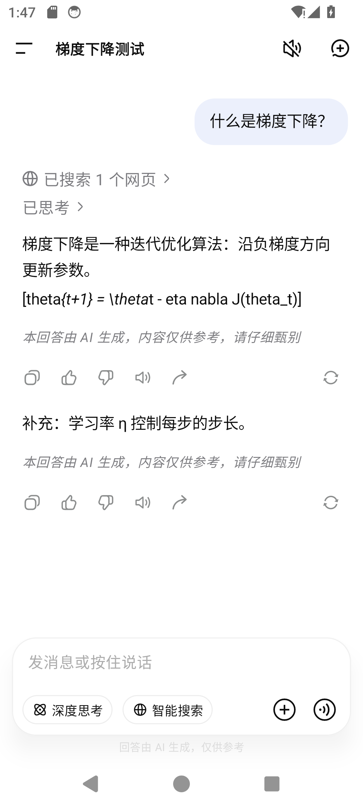
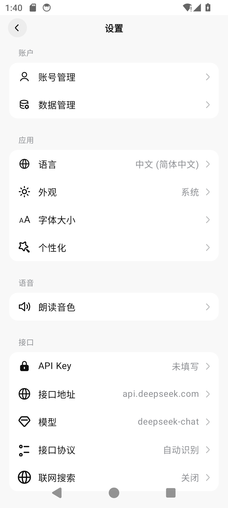
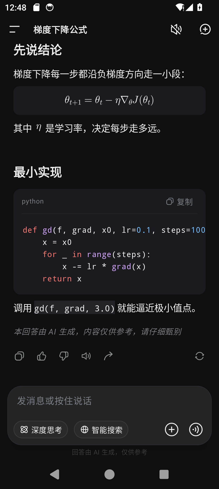

# DS API Chat

一个用 Jetpack Compose 编写的 DeepSeek 官方 App（2.8.0）风格第三方 Android 客户端：界面尽量对齐官方版，但直接调用 DeepSeek 开放平台 API，所有对话保存在本机。

> 本项目是个人学习作品，与深度求索（DeepSeek）**没有隶属关系**。界面布局与图标灵感来自官方 App，相关商标/美术资源著作权归深度求索所有；请勿用于商业用途。使用本项目需要自备 DeepSeek API Key。

## 功能

- **对话**：流式输出、Markdown、代码高亮 + 一键复制、表格、LaTeX 公式（jlatexmath）、思考过程折叠、「智能搜索」联网来源列表
- **消息操作**：复制 / 点赞 / 点踩 / 朗读（系统 TTS）/ 分享 / 重新生成；长按菜单（选择文本、举报等）
- **附件**：拍照、相册（应用内自绘选择器）、文件，经 DeepSeek Files API 上传，支持图片问答
- **语音输入**：调用系统语音识别（RecognizerIntent）
- **会话管理**：重命名、置顶、多选、删除，搜索本机会话
- **设置**：语言、外观（系统/浅色/深色）、字体大小（含跟随系统）、朗读音色、个性化、数据管理
- **数据管理**：**导入 DeepSeek 官方「导出所有历史对话」zip**、导入本应用 JSON 备份、导出全部对话、清空数据
- **分享页**：全选 / 生成图片 / 复制链接 / 分享到微信 / 更多分享
- **平板 / 宽屏**：屏幕宽 ≥760dp 时聊天、分享页、附件面板自动限宽居中，设置页限宽 720dp，相册网格按屏宽自适应列数；手机布局保持不变

## 截图

| 聊天 | 设置 | 深色模式 |
| --- | --- | --- |
|  |  |  |

## 下载与安装

1. 到 [Releases](https://github.com/Stickerbug/ds-api-chat/releases/latest) 下载最新的 `DS-API-Chat-<版本>.apk`。
2. 在手机上允许「安装未知应用」，安装 APK（要求 Android 8.0+，minSdk 26）。
3. 也可以用 adb：`adb install -r DS-API-Chat-1.0.2.apk`。
4. 打开 App → 侧栏「设置」→「接口」：
   - **API Key**：在 [platform.deepseek.com](https://platform.deepseek.com/api_keys) 申请
   - **接口地址**：默认 `https://api.deepseek.com`
   - **模型**：`deepseek-chat`（也可填 `deepseek-reasoner`）
   - **接口协议**：自动 / OpenAI 兼容 / Anthropic 兼容
5. 返回首页即可开始对话。

API Key 只保存在本机应用私有目录（SharedPreferences），除发送给你填写的 API 地址外不会传到任何第三方。

## 导入 DeepSeek 历史对话

1. 在 DeepSeek 官方 App / 网页端「设置 → 数据管理 → 导出所有历史对话」，拿到一个 zip。
2. 打开本应用：设置 → 数据管理 → **导入对话**，选择该 zip。
3. 解析规则与官方导入一致：按对话的 `current_node` 只导入**当前分支**（重新生成掉的旧回答不会导入），思考内容进入「已思考」，搜索来源进入「已搜索网页」。
4. 重复导入会自动跳过重复对话，可以放心多次导入。

导出：设置 → 数据管理 → **导出所有历史对话**，会把全部对话写成 JSON 备份；该 JSON 也能再导入。

导入格式兼容：
- DeepSeek 官方导出 zip（内含 `conversations.json`，`mapping` 节点树 + `REQUEST / RESPONSE / THINK / SEARCH` fragments）
- 本应用导出的对话 JSON 数组

## 构建

环境要求：

- JDK 17
- Android SDK Platform 35、Build-Tools 35
- Gradle 8.9（仓库自带 Gradle Wrapper，可直接用 `./gradlew`）

```bash
# Debug
./gradlew assembleDebug
# Release（未签名，用你自己的 keystore 签名后再分发）
./gradlew assembleRelease
```

产物在 `app/build/outputs/apk/`。也可以用 Android Studio 直接打开本目录构建运行。

## 隐私说明

- API Key 与对话数据只存在本机。
- 应用没有账号体系、没有自建服务器；分享页的「复制链接」等为本地实现（不复刻官方的服务端分享链接）。
- 联网仅用于：请求你配置的 DeepSeek API（对话 / 附件上传 / 联网搜索）。

## 已知限制

- 朗读依赖系统 TTS 引擎，不同机型音色差异较大；朗读音色页目前是界面复刻，未接入官方云端音色。
- 「生成图片 / 分享到微信」等分享动作依赖本机能力，未安装对应应用时会提示。
- 官方服务端能力（分享链接、云端数据管理等）未实现。
- 主要在 1084×2412 手机上逐像素校准；平板/宽屏（Redmi Pad SE 1920×1200、模拟器 1920×1200@280dpi）已适配内容限宽，细节可能与手机版略有差异。

## 目录结构

```
app/src/main/java/io/github/stickerbug/dsapichat/
├── api/         DeepSeek / OpenAI / Anthropic 兼容协议、流式解析、Files API
├── data/        对话模型、本地存储、导入解析（ConversationImport）
├── ui/
│   ├── chat/        聊天页、输入栏、附件面板、相册选择器、分享页、消息菜单、TTS
│   ├── home/        侧栏、首页
│   ├── markdown/    Markdown / 代码高亮 / 公式
│   ├── settings/    设置页与各子页、弹窗
│   └── theme/       浅色 / 深色主题
└── MainActivity.kt
```

## 更新日志

- **1.0.2**：修正侧栏「多选」按钮与长按菜单图标——按官方基准重绘 checklist 图标（双圆 + 短横线，ink 13.3×12.7dp），菜单图标盒统一 18dp、文字列与官方对齐。
- **1.0.1**：平板 / 宽屏适配——聊天与分享页内容区限宽 760dp 居中、附件面板限宽 560dp、设置页限宽 720dp、相册网格按屏宽自适应列数；「回到底部」按钮跟随内容区右缘。
- **1.0.0**：首个版本（聊天、附件、分享页、导入导出、深浅色、设置页等）。

## 许可

代码以 [MIT License](LICENSE) 开源。

DeepSeek、DeepSeek 图标及相关商标、界面设计归杭州深度求索人工智能基础技术研究有限公司所有；本项目与该公司无隶属关系，仅用于学习交流。
